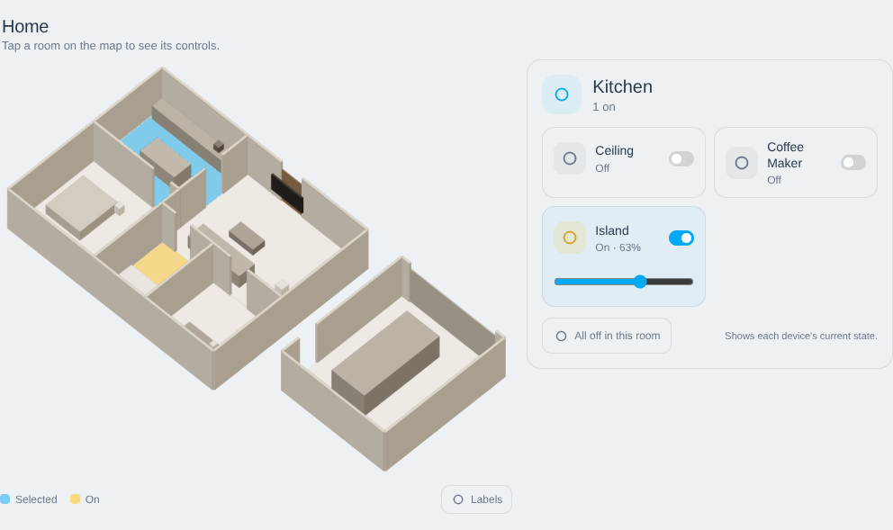
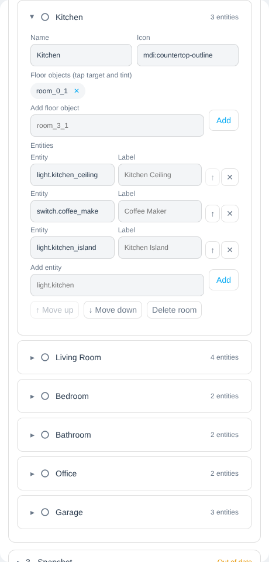
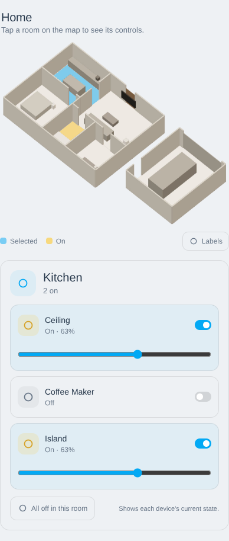
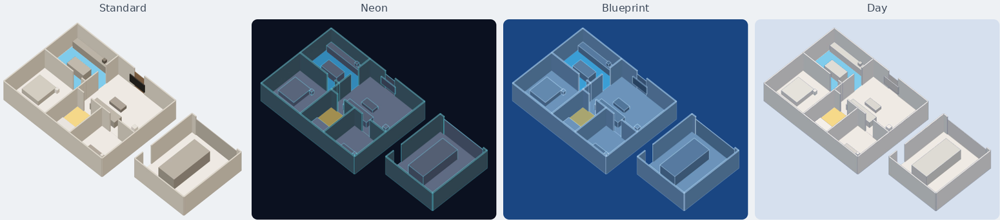
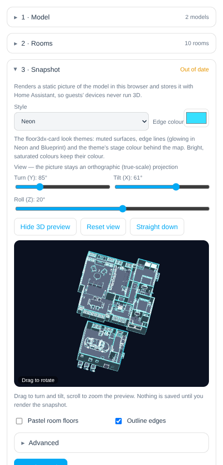
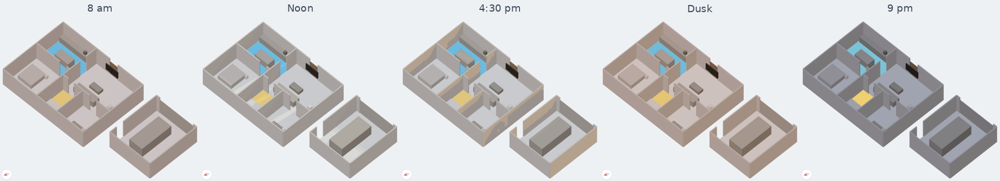
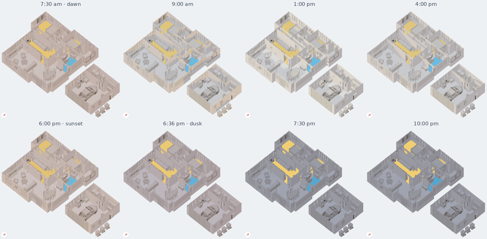

# Floor3D Snapshot Card

Turn the 3D model behind a [floor3d-card](https://github.com/adizanni/floor3d-card), [floor3dpro-card](https://github.com/levonisyas/floor3dpro-card) or [floor3dx-card](https://github.com/FortranFour/floor3dx-card) into a **fast, tappable floor plan** with simple room controls — for wall tablets, phones, guests and anyone who doesn't need the full 3D experience.

Built-in sample:


Actual card created from existing floor3dx-card:


- **Static and light.** The card shows a pre-rendered isometric picture of your model. Tablets and phones download one ~34 KB module and two images (typically 100–200 KB); no 3D runs on them.
- **Tap a floor, get its controls.** Each room's floor is the button. The selected room is washed in your theme color, rooms with something on glow amber, and a mouse hover names the room. Pins stay hidden so the picture stays clean (a **Labels** toggle shows them).
- **Built from your floor3d card.** The visual editor finds floor3d cards in your dashboards, loads the model, detects rooms, names them, and places the card's lights, switches, fans, covers, media players, thermostats and locks into the room each one stands in. You review and edit.
- **Four styles.** Standard, or the Neon, Blueprint and Day look themes of [floor3dx-card](https://github.com/FortranFour/floor3dx-card), each on its own stage colour.
- **See-through walls.** One slider makes every wall transparent by the amount you choose, so rooms behind walls show and can be tapped.
- **Any view angle.** Turn (Y), tilt (X) and roll (Z) the model in a live 3D preview in the editor. The picture is always an orthographic, true-scale projection.
- **Sunlight (optional).** Shading and wall shadows follow the real sun across your house through the day, from your Home Assistant location and a north direction you set. Dawn and dusk turn warm, night turns a muted blue, and rooms with lights on glow after dark.
- **Guest mode** (on by default): locks can only be locked, garage doors and gates only closed, alarms are read-only, TV volume is capped, thermostats can be limited to a range.

| Editor | Phone |
|---|---|
|  |  |

## Install

**HACS:** HACS → ⋮ → *Custom repositories* → add `https://github.com/FortranFour/floor3d-snapshot-card` as type **Dashboard**, then install *Floor3D Snapshot Card*. HACS adds the resource `/hacsfiles/floor3d-snapshot-card/floor3d-snapshot-card.js`.

**Manual:** download all files attached to the [latest release](https://github.com/FortranFour/floor3d-snapshot-card/releases) into `/config/www/floor3d-snapshot-card/` and add `/local/floor3d-snapshot-card/floor3d-snapshot-card.js` as a JavaScript module resource. Keep the other files beside it — the editor loads them on demand.

## Set up (visual editor)

Add a card → **Floor3D Snapshot**, then work down the editor:

1. **Model** — *Find floor3d cards in my dashboards* lists every floor3d-family card you can read; pick one (or two, e.g. house and detached garage — the second is placed beside the first). Or paste a model URL (`.glb`, `.gltf` or `.obj` + `.mtl`).
2. **Rooms** — *Detect rooms from the model* finds the floor objects (`room_N_1`, as Sweet Home 3D exports them), names each room from the floor3d entity bound to that floor (e.g. `input_button.floor3d_kitchen` → *Kitchen*), and assigns the floor3d card's entities to the room they stand in. Tick *Also add sensors* first if you want temperatures, doors and windows too. Then rename rooms, change icons, add or remove entities, set labels, reorder. Rooms without a floor object (a porch, or a group like *Outdoor Lighting*) show as a pin on an anchor object; the editor suggests anchors from the floor3d objects bound to the room's entities. A room with neither appears as a button under the map.
3. **Snapshot** — pick a style, set the view (open *Show 3D preview* and drag, or use the Turn / Tilt / Roll sliders), then *Render snapshot*. Rendering runs in your browser (a few seconds to ~20 s for a large house) and the two images are saved in Home Assistant's image store. If you later change rooms, models or the view, the editor marks the snapshot *Out of date*.
4. **Sunlight** — optional; see below.
5. **Display** — title, starting room, layout, guest-mode limits.

> Rendering needs WebGL in the browser you edit from (any desktop browser). Guests never need it.

## Styles



*Style* in the Snapshot section offers the standard clay look and the look themes of floor3dx-card 2.x. The first three come from NeonPlan 3D and NextFloor:

- **Neon:** dark navy surfaces with glowing edge lines; *Edge colour* sets the glow (default `#37e0ff`).
- **Blueprint:** shades of blue with pale edge lines.
- **Day:** light grey surfaces with dark navy lines.
- **Paper** (0.6): an architect's drawing, cream card with ink lines.
- **Ember** (0.6): charcoal with a warm cast and amber lines.
- **Pastel** (0.6): the model's own colours, lightened and softened, on a pale stage.
- **Custom colours** (0.6): your own. Four pickers appear under the style: *Dark* (where the model is dark), *Light* (where it is bright), *Edges* and *Stage*; *More custom colours* adds separate light tones for walls and floors, a stage colour for daytime, and how much of the model's own hue shows through. The same colours as floor3dx-card's `look.custom`, and *Find floor3d cards* copies them from a card that uses the custom theme.

Each theme recolours surfaces per pixel, so textures still show as pattern. Walls (`wall…` objects) and floors (`room…`, `floor…`) get their own tints. Bright, saturated colours keep their colour. The card shows the picture on the theme's stage colour; with sunlight on, the stage runs from its night colour to its day colour. If the floor3dx card you pick in *Find floor3d cards* has a `look.theme` or a `north`, the editor copies them in.

## A switch and the bulb behind it

A wall switch that powers a smart bulb has its on/off on one entity (`switch.…`) and its brightness on another (`light.…`). Give the room entry a `dimmer`: the tile still switches the switch, and while it's on, it shows the bulb's brightness and a slider that sets it. The editor shows a *Dimmer* field under every switch, and fills it automatically from the floor3d card's `color_entity` (floor3dx-card's link from a switch to the bulb behind it) when you detect rooms or run *Find floor3d cards*.

## Text and picture panels

A floor3d card often shows sensor values and pictures on flat panels in the model (`type3d: text` and `type3d: image`). In a static snapshot those are blank frames, so the card hides them: *Find floor3d cards* records, per model, the objects the card binds as text or pictures, and the render hides each one (resolved as floor3d does, by the first object of that name) together with unused spares beside it, i.e. flat objects of the same size and name family, such as the empty slots in a stack of label frames. Untick *Hide the floor3d card's text and picture panels* in the Snapshot section to keep them. *Hide objects matching* (Advanced) still hides anything else by name, in every model.

**Edge lines without the seams.** An exported model has lines that are not outlines: a straight wall exported in segments shows a joint where their end faces meet; a wall with a window is built from overlapping pieces (full height either side, one under the sill, one over the lintel) and shows a vertical line under each sill and over each lintel; two rooms' floors meet along a border no wall stands on. *No lines on wall seams and room borders* (on by default, in the Snapshot section next to *Outline edges*) drops those: edges are cut where other vertices lie on them, and each part is judged on its own, so a face pressed against another piece counts as hidden there and a surface that continues on the far side means no outline, while jambs, sills, corners and object contours keep theirs. Walls and floors are told apart by the *Wall objects* and *Floor objects* prefixes (Advanced). The same rule as floor3dx-card's `look.edge_skip: seams, floors`.

## Wall transparency

*Wall transparency* in the Snapshot section (0–90 %) makes every wall object see-through by that amount: one global setting, no per-wall configuration. Walls are the objects whose names start with `wall` (Sweet Home 3D's `wall_0_1`, `wall_0_2`…); change the prefix under *Advanced → Wall objects* if your model names them differently. Wall outlines stay, so the plan keeps its shape.


From 30 % up, walls no longer block taps: a floor seen through a wall can be tapped, and its selected or "on" tint is drawn only as strongly as the wall lets it show. It works with every style and with sunlight.

## View and 3D preview



*Show 3D preview* loads the model in the editor, styled as it will render. Drag horizontally to **turn** (Y) and vertically to **tilt** (X). The **Roll** slider (Z) turns the picture about the view axis, and the scroll wheel zooms the preview only. *Reset view* returns to the default isometric view (turn 45°, tilt 52°, roll 0°), and *Straight down* gives a plan view. Whatever the angle, the snapshot is an orthographic projection: no perspective, so rooms keep their true proportions and taps land where they look. Nothing changes for guests until you press *Render snapshot*.

## Sunlight



The same on a real home (two floor3dx models, house and detached garage), mid-October:



Tick **Simulate sunlight** in the editor's *Sunlight* section and render the snapshot again. The render then adds a small lighting image (typically 80–150 KB, downloaded only when sunlight is on). It holds each pixel's depth and surface direction, so the card can relight the picture in 2D. Guests' devices still run no 3D.

- **Sun position** is calculated from Home Assistant's home location (*Settings → System → General*) and the viewer's clock. It updates every 10 minutes, every 4 minutes around sunrise and sunset, and every 30 minutes deep in the night, with a slow cross-fade.
- **North** is in degrees clockwise from the top of the floor plan, the same as the compass *North direction* in Sweet Home 3D. The north arrow on the map lets you check it. Changing it doesn't need a new render.
- The layer only darkens and tints; it never brightens, so the picture can't wash out. **Strength** sets how far it goes.
- Drag **Preview today at…** to scrub through the day in the editor. The preview never reaches guests.

## Configuration

The editor writes everything. For reference:

```yaml
type: custom:floor3d-snapshot-card
title: Our Home
subtitle: Tap a room on the map to see its controls.
models:
  - url: /local/floor3d/house.glb
    panels: [1_13, 1_15, 1_24]   # written by "Find floor3d cards": its text/picture objects
  - url: /local/floor3d/garage.glb
    place: east            # east | west | north | south | as-is
    rotate: 0
view:
  style: neon              # standard | neon | blueprint | day | paper | ember | pastel | custom
  accent: '#37e0ff'        # neon edge colour
  # custom: { dark: '#1c2230', light: '#6c7a96', edges: '#e8f0ff', stage: '#10141c',   # style: custom
  #           walls: '#6c7a96', floors: '#6c7a96', stage_day: '#10141c', hue: 0.15 }
  azimuth: 45              # turn (Y), degrees
  elevation: 52            # tilt (X), degrees; 90 looks straight down
  roll: 0                  # roll (Z), degrees
  wall_transparency: 40    # percent, 0–90; every wall object
  walls: wall              # name prefix(es) of wall objects
  room_colors: false       # pastel floors instead of neutral
  edges: true
  hide: "^room_\\d+_2$|^Frame"            # ceilings and text frames
  fixture_names: "^fan_|^Fluorescent_strip" # hanging fixtures to hide
rooms:
  - id: kitchen
    name: Kitchen
    icon: mdi:countertop-outline
    floors: [{ model: 0, object: room_0_1 }]
    entities:
      - entity: light.kitchen_island
        name: Island           # optional label
      - entity: switch.kitchen_sink          # a wall switch…
        dimmer: light.kitchen_sink_bulb      # …and the bulb behind it, for brightness
      - entity: sensor.kitchen_temperature
        read_only: true        # show state only
  - id: porch
    name: Porch
    anchor: { model: 0, object: porch_light }   # pin-only room
    pin_offset: [2, -3]                          # nudge pin, % of image
    entities: [{ entity: light.porch }]
default_room: kitchen
layout: auto               # auto | side | stacked
room_list: ""              # "" (rooms the map can't show) | always | never
sun:
  enabled: true
  north: 30                # degrees clockwise from the plan's top
  strength: 0.6            # 0.2–1
  shadows: true
  night_glow: true         # rooms with lights on glow after dark
  compass: true            # north arrow on the map
  # latitude: 47.6         # optional; defaults to Home Assistant's location
  # longitude: -122.3
guest_mode: true
max_volume: 0.6
temperature_range: [64, 78]
snapshot:                  # written by the editor's Render button
  image: /api/image/serve/<id>/original
  index: /api/image/serve/<id>/original
  light: /api/image/serve/<id>/original      # with sunlight on
  aspect: 1.096
  rooms: { kitchen: { pin: [52.1, 47.3], code: 1 } }
```

### What each entity becomes

| Domain | Control |
|---|---|
| `light` | toggle, brightness slider when on |
| `switch` with a `dimmer` | toggle; while on, a brightness slider for the light behind it |
| `switch`, `input_boolean`, `remote`, `humidifier` | toggle |
| `fan` | toggle; Off/Low/Med/High when speeds are supported |
| `media_player` | power toggle; volume slider (capped in guest mode) |
| `cover` | Open / Stop / Close — *Close* only for garage, gate and door covers in guest mode |
| `climate` | current mode and temperature, − / + setpoint (within `temperature_range`) |
| `lock` | Lock (tap twice to confirm); Unlock only with guest mode off |
| `scene`, `script`, `button`, `input_button` | Run (tap twice) |
| `sensor`, `binary_sensor`, `alarm_control_panel`, others | state only |

## How it works

The editor loads three.js (only for you, while editing) and renders the model with ceilings, hanging fixtures and text frames removed, crease-only edge lines, and an isometric camera cropped to the building. It also renders a **room index**: each room's visible floor in a flat code color with walls and furniture occluding it. That PNG doubles as the picture's transparency mask, so the JPEG blends into any theme, light or dark. The card decodes the index once to know exactly which room a tap lands on and to paint the selected/active floor washes. Pins sit on each room's visible floor.

With sunlight on, the picture is rendered with even, overhead light, and a third pass bakes camera depth and surface direction at half resolution. On the viewer's device, the card computes the sun's azimuth and elevation, shades each surface by its angle to the sun, and traces shadows across the depth image toward the sun. It multiplies the result, tinted for the time of day, over the picture.

Images go to Home Assistant's built-in image store (`/api/image/upload`, served from `/api/image/serve/…`), the same place the picture-card editor uploads to; re-rendering deletes the previous pair. Choose *Embed in this dashboard* under *Snapshot → Advanced* to store them in the card configuration instead.

## Security

A dashboard is not a security boundary. Give guests a non-administrator Home Assistant user and use Home Assistant's own permissions for anything that must be enforced. The card only ever calls services on the entities you put in its rooms.

## Development

```bash
npm install
npm run build            # dist/ (every file is a release asset)
node dev/make-demo.mjs   # regenerate the demo home model
node dev/test.mjs --demo # headless end-to-end test (editor → render → card → sunlight)
node dev/edges-test.mjs  # edge-line rules on a hand-built scene (no browser)
node dev/style-test.mjs --demo  # each style rendered and screenshotted
node dev/sun-test.mjs --demo --lat 47.6 --lon -122.3 --tz America/Los_Angeles   # screenshots through a day
node dev/server.mjs      # then open http://127.0.0.1:8123/?fixture=demo
```

`dev/` contains a harness with a simulated Home Assistant (dashboards, states, image store). Put your own model and dashboard JSON in `dev/private/` (git-ignored) to test against your home.

## Credits

Built on [three.js](https://threejs.org). The look themes are ported from [floor3dx-card](https://github.com/FortranFour/floor3dx-card)'s `look`, itself adapted from [NextFloor](https://github.com/therealMRBK/NextFloor) (MIT), after [NeonPlan 3D](https://github.com/Mastershort/neonplan3d). Sun position from the NOAA solar equations. Thanks to [adizanni/floor3d-card](https://github.com/adizanni/floor3d-card) and [levonisyas/floor3dpro-card](https://github.com/levonisyas/floor3dpro-card), whose model conventions this card reads. MIT licensed.
